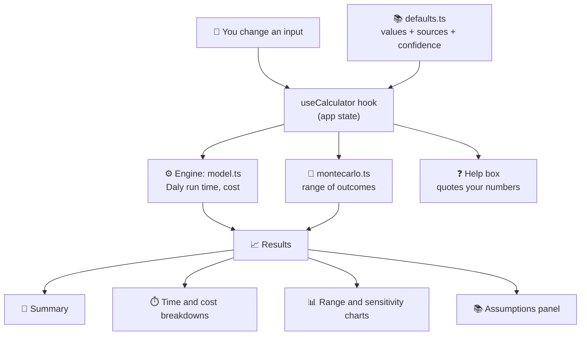
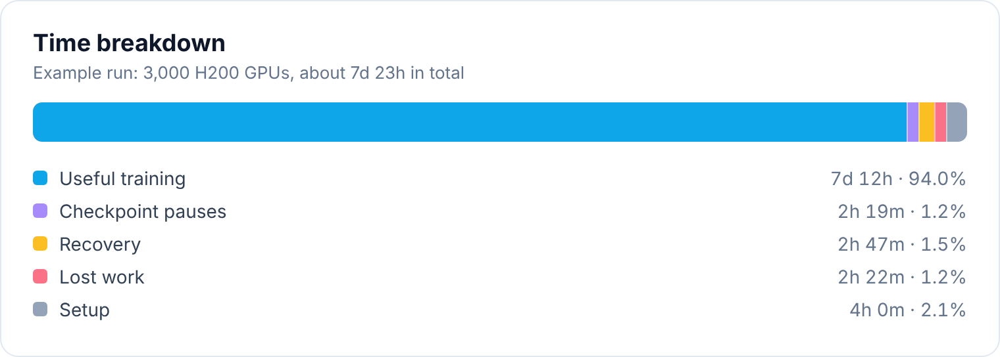

<div align="center">

# 🧮 GPU Training Calculator: Edition-1

**What does a large GPU training run really take, in time and in money?**

Most estimates stop at the GPU's speed. This one also counts the crashes, checkpoints, recovery and setup that a real cluster adds.


</div>

---

## ✨ What it does

| | Feature |
|---|---|
| 💬 | **Plain-English summary** that rewrites itself as you change any input: finish time, expected crashes, lost work, and the cost of GPU time that is not training |
| ⏱️ | **Time breakdown** into useful training, checkpoint pauses, recovery, lost work and setup |
| 💷 | **Cost breakdown** into GPU, storage, egress, people and contingency, plus an effective price per *useful* GPU-hour, the number to compare between providers |
| 🎲 | **Range of outcomes** from a simulation, because crashes land at random: a lucky, a typical and an unlucky run |
| 📊 | **"What matters most"** sensitivity chart showing which assumption moves the total the most |
| 📚 | **Sourced defaults**: every default carries a source and a confidence label (vendor, measured or assumption) |
| ❓ | **Help box** with written answers that quote your current numbers. No AI and no server |

## 🏗️ How it fits together



Everything runs in the browser. There is no backend, no account and no data leaves your machine.

## 🔬 How the numbers are worked out

| Quantity | Method |
|---|---|
| ⚡ Pure training time | ideal hours at 100% speed ÷ MFU (model FLOPs utilisation) |
| 💥 Crashes | rate per 1,000 node-days, where a node is 8 GPUs; MTBF = 1,000 ÷ (nodes × rate) days |
| 💾 Checkpoint interval | Auto uses the Young–Daly rule, or enter your own |
| 🕐 Total run time | Daly's (2006) wall-time model, which lets a crash strike during training, a checkpoint, recovery or re-done work |
| 🖥️ GPU cost | GPUs × price per GPU-hour × billed hours (pay-as-used, or a reserved block) |
| 💰 Total cost | GPU + storage + egress + people + contingency |

## 🚀 The starting example

3,000 H200 GPUs, a job that would take 72 hours at 100% speed, 40% MFU, $5.40 per GPU-hour, Auto checkpoints with a 20 second pause, a crash rate measured on Meta's Llama 3 run, a 15 minute recovery and 4 hours of setup.

That comes out at roughly **191 hours**, about **11 crashes** and about **$3.10M**. Pure training would take 180 hours, so the extra 11.5 hours come from the things most estimates leave out:



Change any input to see what it does. The crash-rate and recovery dropdowns list other published figures to try.

## 📚 Sources

Crash rates and recovery times come from published reports, including Meta's Llama 3 report (2024), Sivathanu et al. 2024 (arXiv 2410.21680), Lablup 2026 (arXiv 2605.09370) and figures Nebius published in October 2025. GPU prices are list prices from the provider's public price page and can change. The full table, with a confidence label for each value, is in [`docs/SOURCES.md`](docs/SOURCES.md).

## 🛠️ Run it

You need [Node.js](https://nodejs.org) installed.

```bash
npm install
npm run dev      # start the app
npm test         # run the tests
```

## ✅ Tests

The calculation engine has unit tests, including a Monte Carlo simulation that cross-checks the closed-form run-time model, a replication of a published worked example, and checks that the time and cost breakdowns add up to their totals.

## 🗂️ Project layout

```
src/
  components/   interface sections, results, Help box, header
  data/         default values and their sources
  hooks/        calculator state
  lib/          calculation engine, simulation, formatting, the orb animation
docs/
  SOURCES.md    every default, its source and its confidence
```

## ⚠️ Limits

- It is an estimate, not a quote, and not financial or procurement advice.
- Daly's model has been checked against its author's own simulation, not against a live cluster.
- Crash rates vary a lot between clusters, chips and software. Recovery time and setup time are often assumptions, and the app labels them as such.
- Prices change. Check the provider's current price page before you commit money.

## 🤖 Disclosure

Built with AI assistance (Bolt.new, Claude). The author directed the design, reviewed the results and is responsible for the project.

## 🤝 Independence

This is an independent project. It is not affiliated with, endorsed by or sponsored by any provider, chip maker or research group named in it. Names such as Nebius, Meta and NVIDIA appear only to cite published figures, and all trademarks belong to their owners. Any errors are mine.

## 💬 Feedback

Feedback and corrections are welcome, especially better crash-rate, recovery-time or price data with a public source. Open an issue on this repository or email info@naadimage.com.

## 📄 Licence

MIT. See [`LICENSE`](LICENSE). Three.js, React, Tailwind CSS and lucide-react keep their own licences.
